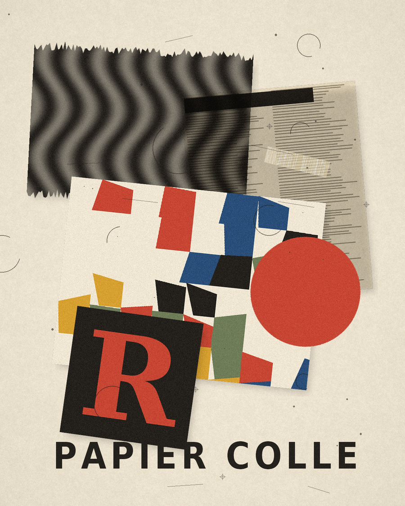
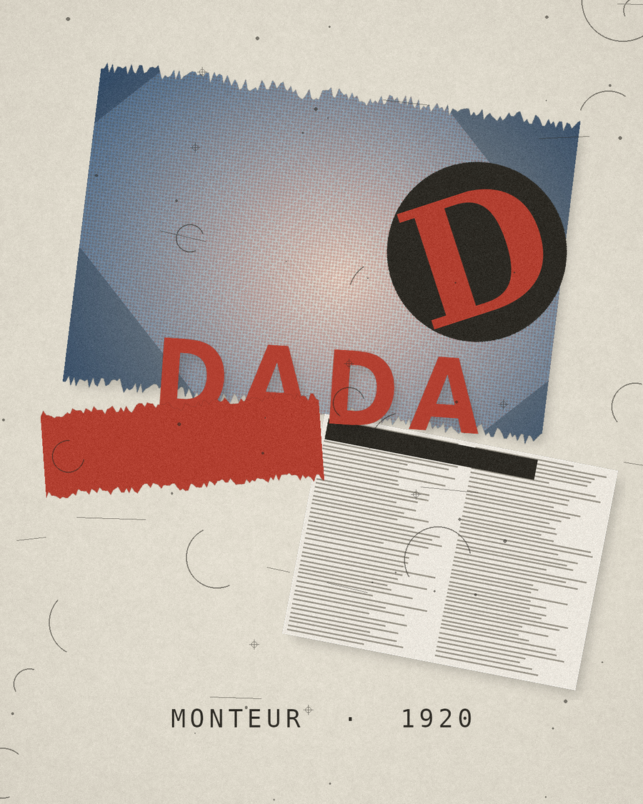
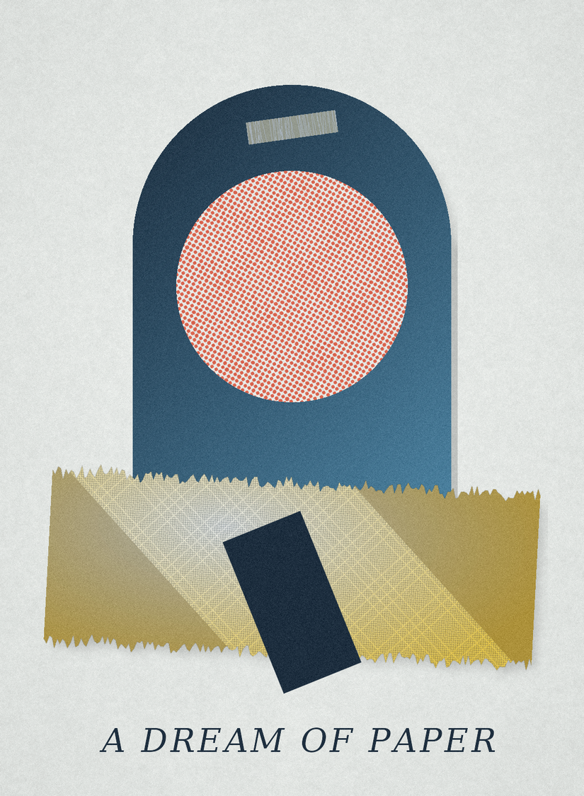
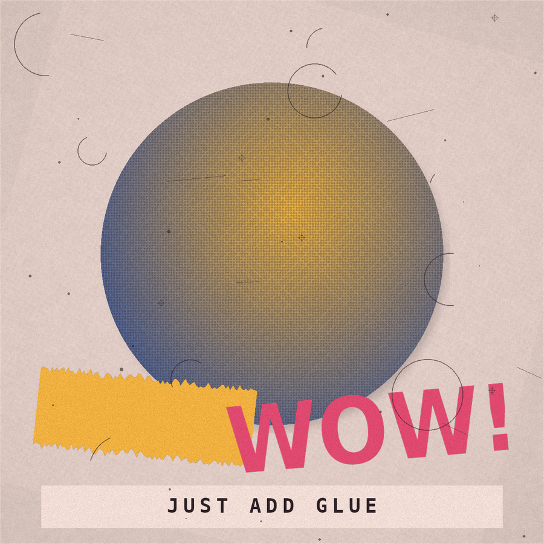
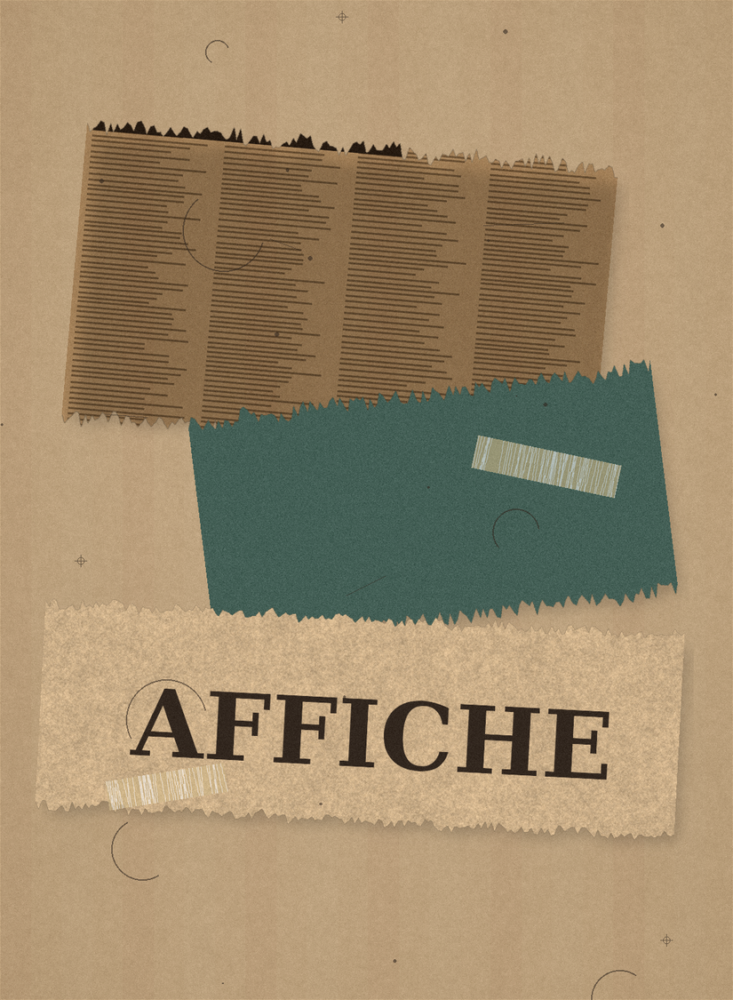
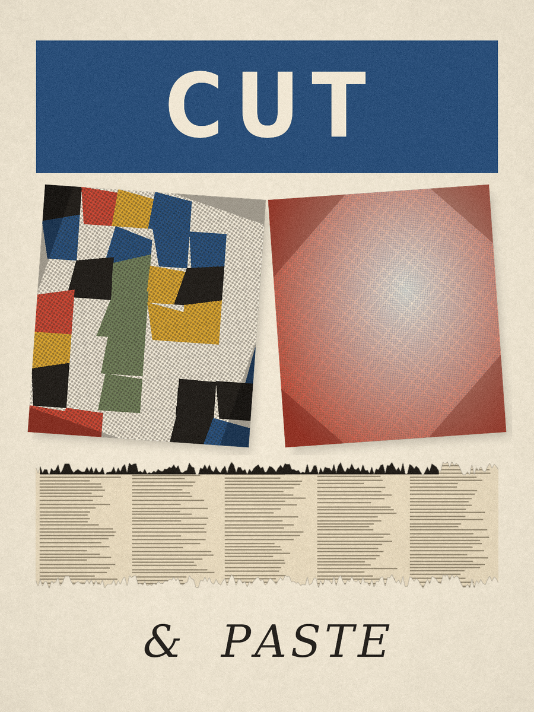
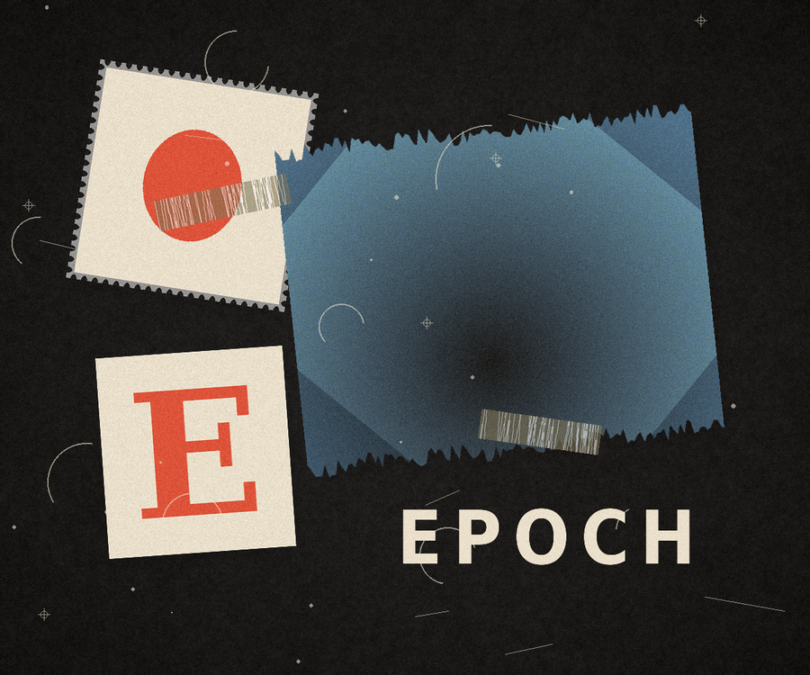

# ewen-collage

A [Claude skill](https://code.claude.com/docs/en/skills) by **Ewen** that turns a
theme, a brief, or a passage of text into a finished collage artwork.

Give it a topic or a paragraph. It reads the text, finds the tension in it,
translates that into concrete visual motifs, searches for its own licensed
source photographs, and composites them into a printed-paper assemblage —
halftone, torn edges, tape, pencil marks and all.

```text
"潮水一次次回来，城市却装作睡着"  →  TIDE / CITY  →  [900×1125 PNG]
```

[See the worked example](examples/demo/tide-city.png) · [Its decision log](examples/demo/recipe-rationale.md) · [Its image credits](examples/demo/assets/SOURCES.json) · **[Project page and full gallery →](https://ewen2015.github.io/ewen-collage/)**

## Why the names are split

The repo carries the author's name (`ewen-collage`); the skill does not
(`collage-art`). Skill names are **functional identifiers** — they show up in
slash commands, in plugin namespaces and in searches, and the ecosystem
convention is descriptive names (`pdf`, `xlsx`, `frontend-design`) rather than
personal ones. Putting a personal name in a skill name is uncommon for published
skills: it makes discovery worse, it ties a reusable tool to one identity, and
if others install several of your skills, the name stops telling them what the
skill does. Names belong in `metadata.author`, the plugin manifest, the README
and the LICENSE. That is the pattern used here.

## Install

Copy the `skills/collage-art/` directory into your skills folder, or install
this repo as a plugin (the `.claude-plugin/plugin.json` manifest is included).
Requires Python 3.9+, Pillow and NumPy. Image sourcing also needs network
access; everything else works offline.

```bash
pip install Pillow numpy
```

Then just ask: *"Make a collage poster about the tide and a sleeping city"* or
paste a paragraph and ask for a collage.

## What it does

1. **Extract** — reads the text, names the tension, writes a one-sentence
   pairing ("X meets Y, which suggests Z") and 2–4 photographable motifs.
2. **Source** — searches Wikimedia Commons for each motif, keeps only
   CC BY / BY-SA / CC0 / public-domain results, downloads them and writes an
   attribution manifest.
3. **Compose** — picks an art-historical strategy (Cubism, Dada, Surrealism,
   Pop, Décollage, editorial), a composition system, edges, rotations and type,
   and compiles a recipe JSON.
4. **Render** — a deterministic Pillow renderer produces the PNG: paper fibre,
   halftone screening, torn edges, print registration, shadows, tape, grain.
5. **Verify** — checks the image against a list of anti-patterns, then explains
   the choices and credits the sources.

The guidance comes from three references: [Rise Art's *A Guide to Collage*](https://www.riseart.com/guide/2371/a-guide-to-collage)
(definition, *coller*, papier collé / assemblage / décollage / photomontage,
Heartfield, Schwitters), [Artsy's Collage gene page](https://www.artsy.net/gene/collage)
(2D assemblage, Picasso's 1912 *Still Life with Chair Caning*, Schwitters'
street ephemera, collage as a technique rather than a movement), and
[优设网 UISDC's 实战演示！如何把拼贴艺术运用到平面设计中？](https://www.uisdc.com/tiles-in-graphic-design)
(断裂·重组·融合, point-line-plane and colour-block vocabulary, and the
extract-elements-then-rebuild method). Full notes are in
[`skills/collage-art/references/movements.md`](skills/collage-art/references/movements.md).

## Repository layout

```text
ewen-collage/
├── .claude-plugin/plugin.json       plugin manifest (author: Ewen)
├── README.md                        this file
├── LICENSE                          MIT, © Ewen
├── skills/
│   └── collage-art/                 ← the skill (name: collage-art)
│       ├── SKILL.md                 end-to-end workflow
│       ├── references/              movements, materials, composition, prompts, schema
│       ├── scripts/
│       │   ├── collage.py           renderer (Pillow + NumPy)
│       │   ├── source_assets.py     Commons search + attribution manifest
│       │   └── theme_to_recipe.py   concept → recipe compiler
│       └── assets/                  optional local source images
├── docs/                            GitHub Pages site (index.html + 19 works)
└── examples/
    ├── gallery/                     16 built-in style presets
    └── demo/                        full theme → artwork worked example
```

## Gallery

Sixteen built-in presets, each encoding a different art-historical strategy
rather than just a colour scheme. [Browse all of them on the project page](https://ewen2015.github.io/ewen-collage/#gallery), or see the first seven here.

| | | |
| --- | --- | --- |
|  |  |  |
| `cubist-grid` | `dada-montage` | `surreal-arch` |
|  |  |  |
| `pop-halftone` | `decollage-poster` | `riso-editorial` |
|  | | |
| `analog-scrapbook` | | |

```bash
python3 skills/collage-art/scripts/collage.py --list
python3 skills/collage-art/scripts/collage.py --preset cubist-grid --out cubist.png --seed 4
```

## Run the pipeline manually

```bash
JOB=examples/my-job && mkdir -p $JOB

# 1. Write $JOB/concept.json following skills/collage-art/references/concept-schema.md
#    (normally the agent does this for you from your text)

python3 skills/collage-art/scripts/source_assets.py --concept $JOB/concept.json \
    --out-dir $JOB/assets --per-motif 1
python3 skills/collage-art/scripts/theme_to_recipe.py --concept $JOB/concept.json \
    --assets $JOB/assets --recipe $JOB/recipe.json --seed 11 --format poster
python3 skills/collage-art/scripts/collage.py --recipe $JOB/recipe.json --out $JOB/final.png
```

Every step produces a readable artefact — `concept.json`, `SOURCES.json`,
`recipe.json`, `recipe-rationale.md` — so you can inspect and revise any decision
instead of treating the output as a black box.

## Licensing and attribution

Source photographs come from Wikimedia Commons and retain their own licences.
`SOURCES.json` in each job records the author, licence, licence URL and source
page. CC BY / BY-SA works require attribution; BY-SA may additionally require
the combined work to be shared alike. Check the manifest before publishing a
finished piece. Everything else in this repo (code and generated paper textures)
is MIT-licensed.

## Roadmap

- Subject cut-outs (remove backgrounds from sourced photos before pasting)
- Additional image sources with licence filtering
- Multi-page / series output from a long text
