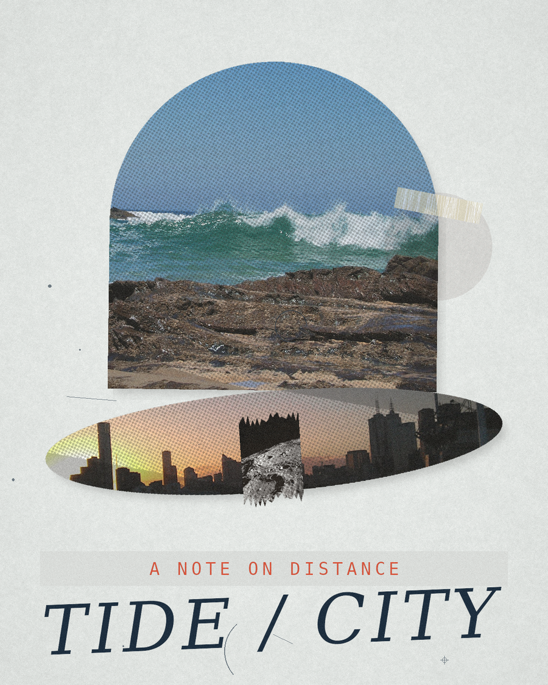

# Worked example: 潮汐与城市 / TIDE / CITY

A full run of the pipeline, from a short Chinese phrase to a finished poster.
Everything in this folder is a real artefact produced by the scripts — nothing
is mocked.

## The brief

> 潮水一次次回来，城市却装作睡着。

## Step 1 — extract

The phrase contains a tension: something that returns versus something that
pretends to be still. That becomes the pairing sentence and three
photographable motifs. Strategy: Surrealism, because the argument is about
distance and one impossible object in a calm frame. See [`concept.json`](concept.json).

## Step 2 — source

```bash
python3 ../../skills/collage-art/scripts/source_assets.py \
    --concept concept.json --out-dir assets --per-motif 1
```

Three images came back from Wikimedia Commons: a breaking wave (CC BY 2.5), a
Melbourne night skyline (CC0), and a lunar crater wall (public domain).
[`assets/SOURCES.json`](assets/SOURCES.json) records author, licence and source
page for each. Note the first search returned a surfer; the query was changed to
`breaking ocean wave water` to get an object rather than a person — a good
example of why Step 5's visual check matters.

## Step 3 — compose

```bash
python3 ../../skills/collage-art/scripts/theme_to_recipe.py \
    --concept concept.json --assets assets --recipe recipe.json \
    --seed 11 --format poster
```

[`recipe.json`](recipe.json) is the layout; [`recipe-rationale.md`](recipe-rationale.md)
explains every decision in plain language.

## Step 4 — render

```bash
python3 ../../skills/collage-art/scripts/collage.py \
    --recipe recipe.json --out tide-city.png --scale 0.75
```



## Image credits

- `tide-01.jpg` — *Breaking wave July 2007-1.jpg*, CC BY 2.5, Wikimedia Commons.
- `city-01.jpg` — *Melbourne City Skyline 2012.jpg*, CC0, Wikimedia Commons.
- `moon-01.jpg` — *Terraced Wall Crater on the Lunar Limb*, public domain (NASA), Wikimedia Commons.

See `assets/SOURCES.json` for authors and links. CC BY / BY-SA terms require
attribution; check the manifest before republishing.
